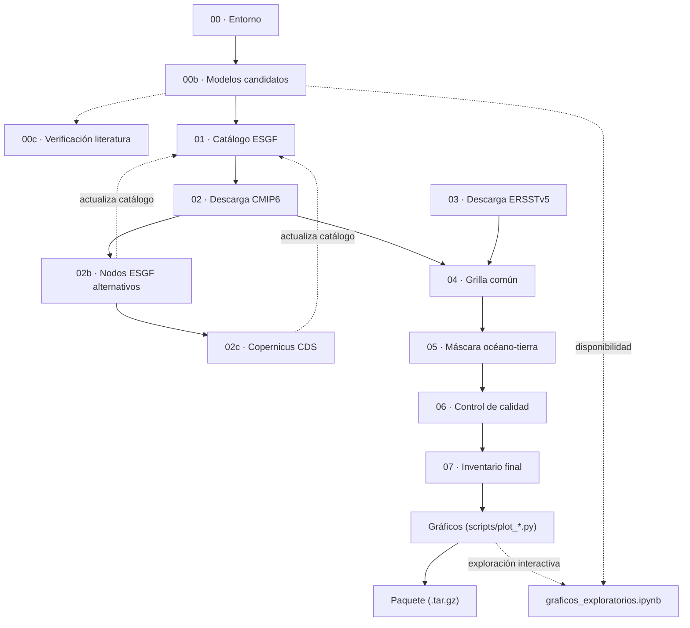

# smn_toe — Influencia del cambio climático en El Niño (CMIP6 + ERSSTv5, Niño 1+2 / Niño 3.4)

Código del servicio de asistencia en investigación para SENAMHI sobre la influencia del cambio climático en el ENOS y sus impactos en el Perú. El objetivo final es el *Time of Emergence* (TOE) de la temperatura superficial del mar (TSM) en las regiones Niño 1+2 y Niño 3.4, a partir de los modelos CMIP6 y de la referencia observacional ERSSTv5.

## Entregables

| Entregable | Contenido | Código | Informe | Estado |
|---|---|---|---|---|
| E1 | Descarga, homogeneización (grilla, calendario, unidades, máscara) y control de calidad de los modelos CMIP6 y de ERSSTv5 | `run.sh`, `scripts/` | `e1_informe/` | Completo |
| E2 | Evaluación histórica de los 40 modelos (estado medio, ciclo anual, variabilidad, índices ONI/RONI/ICEN, eventos cálidos) y selección de los que mejor representan el ENOS | `rune2.sh`, `rune2plot.sh`, `scripts_e2/` | `e2_informe/` | Completo |
| E3 | Proyecciones bajo los escenarios SSP | — | — | Pendiente |
| E4 | Partición de incertidumbre y TOE | — | — | Pendiente |

El E2 solo lee lo que deja el E1 (`data/processed/masked/`): hay que correr primero `./run.sh`. Las secciones de Instalación a "Informe" describen el E1; el E2 está en la sección [Entregable 2](#entregable-2--evaluación-histórica-y-selección-de-modelos).

## Instalación

Una sola vez, en cualquier máquina Linux:

```
conda env create -f environment.yml
```

De ahí en más, alcanza con `./run.sh` — **no hace falta `conda activate` a mano**: `run.sh` activa el entorno `smn_toe` solo si lo encuentra creado, y si no (máquina que todavía no recreó el entorno tras el rename de `e1_smn` a `smn_toe`), cae de vuelta a activar `e1_smn` si ese existe -- mismo entorno, nombre viejo (ver Convenciones más abajo si igual te aparece un error de dependencias faltando).

Se ejecuta con un único orquestador: `run.sh [STEP_FROM] [STEP_TO] [MAX_MODELS]`. Ejemplo para una prueba rápida (desde el entorno hasta la grilla común, con solo 2 modelos):

```
./run.sh 00 04 2
```

El procesamiento numérico usa CDO, salvo la máscara océano-tierra (paso 05), en Python/`numpy`. Al final de cada corrida, `run.sh` genera automáticamente las figuras principales (`scripts/plot_*.py`: los modelos nuevos se grafican solos, sin preguntar; para las figuras que ya existen pregunta una sola vez por lote si regenerarlas, ver la sección "Gráficos" más abajo) y arma un paquete `.tar.gz` con todo lo necesario para actualizar el informe.

## Configuración global (`config/periods.yaml`)

Los experimentos que procesa todo el pipeline (`historical` + los escenarios SSP) se definen en un único lugar: `config/periods.yaml`, clave `escenarios`. Ningún script debe tener una lista de SSP fija en el código: todos leen esta configuración a través de `scripts/pipeline_config.py`, que expone:

- `experiments()` — `historical` + los escenarios configurados, en orden.
- `scenarios()` — solo los escenarios SSP.
- `experiment_year_range(exp)` — rango de años de descarga/recorte por experimento.
- `cds_experiment_name(exp)` — nombre de experimento en el formato de Copernicus CDS.
- `esgf_get(url, params)` — `requests.get(...)` con reintentos ante `429`/5xx (rate limit de ESGF, verificado en la práctica contra el nodo de ORNL) y fallos de red, con backoff exponencial y respeto del header `Retry-After`. Todo script que consulte ESGF (`00b`, `01`, `02b`, `check_model_availability.py`) lo usa en vez de `requests.get(...)` directo.
- `pick_first_live_url(urls)` — `HEAD` rápido (sin bajar el archivo) para confirmar que al menos un mirror de un archivo responde de verdad, antes de darlo por "encontrado" en el catálogo. ESGF a veces indexa un archivo cuyo link ya no está vivo (nodo reorganizado, réplica caída); mejor descartarlo acá que descubrirlo recién en el paso 02, después de intentar la descarga real. Usado por `01` y `02b`; para en el primer mirror que responde, no revisa el resto.
- `esgf_get_all_docs(url, params, retry_full_on_truncate=0)` — pagina (offset/límite) hasta traer todos los documentos de una búsqueda. Para búsquedas a nivel de archivo (`01`, `02b`, con `retry_full_on_truncate=2`), reintenta la paginación COMPLETA desde offset=0 si se corta por un error transitorio a mitad de camino -- bug real encontrado en producción: un corte de red a mitad de la paginación se aceptaba en silencio como "la lista completa" de archivos de un modelo, dejando un catálogo `complete=True` con archivos faltantes desde el origen (verificado: la misma búsqueda de `EC-Earth3 historical` encontraba 107, 121 o 165 archivos -- 165 es el total real -- según la corrida, sin ningún error visible). Para búsquedas de solo-existencia (`00b`, `retry_full_on_truncate=0`, default) el comportamiento no cambia: un corte ahí es aceptable, ver su docstring.

Para agregar o quitar un escenario SSP, alcanza con editar `escenarios` en `config/periods.yaml`; no hace falta tocar los scripts.

## Flujograma



`02 → 02b → 02c` es una cascada **automática** dentro del paso 02 de `run.sh` (`02_download_all_sources.sh`): cada fuente solo se intenta para lo que la anterior no haya resuelto. Las líneas punteadas son pasos manuales (00c), de solo lectura para el notebook (00b, vía su reporte de disponibilidad; y `scripts/plot_*.py`, que cubren lo mismo que el notebook pero sin abrir Jupyter), o actualizaciones que 02b/02c hacen sobre el catálogo de 01.

## Estructura de datos

```
data/raw/cmip6/<modelo>/<experimento>/<chunk>.nc   # 02: crudo, grilla nativa, sin fusionar
data/raw/ersstv5/                                  # 03: observado, crudo
data/interim/.weights/<modelo>.nc                  # 04: pesos de regrilla, uno por modelo (cache)
data/interim/processed/tos_<modelo>_<exp>.nc       # 04: regrillado + fusionado + homogeneizado
data/interim/ocean_mask.nc                         # 05: máscara 1=océano
data/processed/masked/tos_<modelo>_<exp>.nc        # 05: dato final, listo para el cálculo de TOE
data/processed/qc_report.csv                       # 06
data/processed/models_inventory_final.csv          # 07: modelos selected=True (los que se grafican)
figures/e1/                                         # scripts/plot_*.py (automatico, run.sh)
data/processed/e2/                                  # E2: rune2.sh (p01-p09)
figures/e2/                                         # E2: rune2plot.sh (scripts_e2/plot*.py)
```

`data/interim/processed/` es un paso intermedio (regrillado, todavía sin máscara); `data/processed/masked/` es el dato final. `run.sh` genera los PNG de `figures/e1/` el mismo (`scripts/plot_*.py`, al final de cada corrida).

## Pasos

### 00 — Verificación de entorno (`00_setup_env.sh`)
Confirma la disponibilidad de CDO, Python y las librerías necesarias antes de iniciar la ejecución.

### 00b — Lista de modelos candidatos (`00b_build_model_list.py`)
Revisa el vocabulario CMIP6 completo (nodo principal, ORNL — verificado que conoce exactamente el mismo universo de 102 modelos que LLNL) y para cada modelo:

1. Exige `historical` (o su equivalente `hist-1950` de HighResMIP) publicado — requisito duro. Si el nodo principal no lo tiene indexado para ese modelo, prueba nodos ESGF alternativos (8 en total) antes de descartarlo; para los escenarios SSP no hay ese respaldo.
2. Exige además **todos** los escenarios SSP configurados en `config/periods.yaml`, bajo una misma grilla (`grid_label`) — la más gruesa disponible en km reales (convierte grados a km si hace falta), ya que el paso 04 regrilla igual a la resolución de ERSSTv5.

Los modelos que cumplen ambos puntos quedan en `config/models_seed_cmip6.csv` (lo que alimenta la descarga real, paso 01). Además, para **todos** los modelos inspeccionados (no solo los seleccionados), escribe `e1_informe/model_availability_priority.csv` — una fila por modelo con columnas `0`/`1` (`tiene_tos`, `tiene_hist`, `tiene_sspXXX` por cada escenario) y una columna `prioridad` pensada para buscar manualmente en ESGF en el orden que más rinde (sin `tos` → con `tos` pero sin `historical`/`hist-1950` → con historical pero falta el primer SSP configurado → ... → completos al final). Ese reporte **no se versiona** (está en `.gitignore`): es una foto de la disponibilidad al momento de correr 00b, no algo para sincronizar a mano en git.

**Idempotente con detección de cambio**: antes de decidir si hace falta el barrido completo (100+ modelos, varias peticiones cada uno), hace una sola consulta barata (cuántos modelos con `tos`/`Omon` hay ahora) y la compara contra la cantidad de filas del reporte de la corrida anterior. Si coincide, no repite el barrido; si cambió (o es la primera vez), lo rehace — así un modelo nuevo publicado en ESGF se detecta solo.

### 00c — Verificación contra la literatura (`00c_check_paper_models.py`, manual)
Compara los modelos citados en `files_MD/` contra ese catálogo. Los faltantes quedan en `config/models_missing_from_esgf.csv`, insumo manual adicional para 02b si se quiere ampliar el universo de modelos.

### 01 — Catálogo ESGF (`01_query_esgf_catalog.py`)
Para cada modelo, determina el `variant_label` (miembro de ensamble) disponible simultáneamente en todos los experimentos requeridos (prioriza `r1i1p1f1`; si ese no sirve para los cuatro a la vez, usa el de menor número que sí lo haga) y localiza los archivos de esa combinación exacta. Escribe `models_catalog_status.csv` y `esgf_file_urls.json`.

**Idempotente**: si `models_catalog_status.csv` ya existe, no se vuelve a consultar ESGF (8+ peticiones por modelo). Para forzar un refresco (por si algún modelo se completó en ESGF desde la última vez) hay que borrar ese CSV y el JSON juntos a mano. Ojo: si habías resuelto algún modelo a mano por fuera de la semilla (`00c` + `02b`), se pierde del catálogo al borrar y hay que volver a correr `02b` para ese modelo.

### 02 — Descarga CMIP6, en cascada (`02_download_all_sources.sh`)
Encadena automáticamente 3 fuentes, cada una solo para lo que la anterior no haya resuelto:

1. **`02_download_cmip6_chunks.sh`**: descarga cada archivo tal como lo entrega ESGF (nodo principal), sin fusionar ni recortar, en `data/raw/cmip6/<modelo>/<experimento>/`. `MAX_MODELS` limita cuántos modelos completos se descargan. Si un modelo+experimento ya tiene su resultado intermedio (paso 04) o final (paso 05), no vuelve a tocar los crudos en absoluto -- útil si se borraron a mano para liberar espacio después de procesar. Imprime progreso (`archivo N/M`) porque algunos modelos publican un experimento en decenas de chunks sueltos (ej. un archivo por año individual, no contiguo). Cada mirror candidato se reintenta 3 veces (con una pausa corta) antes de pasar al siguiente URL -- un solo corte de red transitorio no debe marcar un chunk como fallido para siempre.
2. **`02b_search_alt_esgf_nodes.py`**: para los modelos `no_encontrado`, repite la búsqueda de 01 contra nodos ESGF alternativos (CEDA, DKRZ, IPSL, NSC, NCI) y actualiza el catálogo.
3. **`02c_download_copernicus_cds.py`**: último recurso, vía Copernicus CDS, **solo para modelos que además están en `config/models_copernicus_available.csv`** -- la lista de modelos que ofrece el selector del dataset `projections-cmip6` en el sitio de Copernicus (confirma que el modelo existe ahí; no garantiza que tenga todos los experimentos requeridos, eso lo resuelve intentando la descarga real). Requiere `~/.cdsapirc`; si no está disponible, el paso se omite sin abortar el resto del pipeline. (`config/models_copernicus_ssp245_whitelist.csv`, más acotada y verificada a mano solo para `ssp245`, queda sin usar como referencia histórica del Entregable 1.) Igual que `02b`, actualiza `models_catalog_status.csv` (`fuente=copernicus_parcial`) para lo que resuelve -- antes no dejaba constancia en el catálogo.

Antes de entrar a (2)/(3), si quedó algún modelo `no_encontrado` en (1), `run.sh` pregunta explícitamente si se quiere intentar (límite de 15s; sin respuesta, o en una corrida no interactiva sin terminal, continúa igual -- nunca bloquea una corrida desatendida).

### 03 — ERSSTv5 (`03_download_ersstv5.sh`)
Descarga el dato observado de NOAA PSL, aísla la variable `sst` y recorta a la ventana regional (100°E–70°W, 20°S–20°N). El resultado (`ersstv5_region.nc`) es la grilla de referencia (~2°) para el paso 04.

### 04 — Procesamiento a grilla común (`04_process_to_common_grid.sh`)
Por modelo:
0. **Filtra los chunks crudos por `grid_label`** (la grilla registrada en el catálogo, misma que usan 01/02b para buscar) antes de tocar nada -- ignora cualquier archivo de otra grilla que haya quedado en `data/raw/cmip6/<modelo>/<experimento>/` de una descarga anterior. Sin este filtro, un chunk de una grilla vieja (caso real: `CESM2` con archivos `gn` **y** `gr` del mismo periodo completo mezclados en la misma carpeta) se mergea igual con el resto y duplica cada mes.
1. **Pesos de regrilla, una sola vez por modelo**: se detecta el `gridtype` nativo (`cdo griddes`) y se calculan los pesos hacia la grilla de ERSSTv5 con `gencon` (mallas no estructuradas, p. ej. AWI-CM-1-1-MR) o `genbil` en los demás casos. Se cachean en `data/interim/.weights/<modelo>.nc` y se reutilizan para todos los experimentos del modelo.
2. `cdo remap` con esos pesos, chunk por chunk (recorta además el dominio a la ventana regional).
3. `mergetime` de los chunks regrillados de un mismo experimento.
4. Recorte de años según el experimento (rango leído de `config/periods.yaml` vía `pipeline_config.py`).
5. Calendario `standard` si no está presente.
6. Conversión de unidades (K → degC) cuando corresponde.
7. **Verifica la lista exacta de meses** (año-mes, vía `cdo showdate`, no solo el conteo) contra lo que prometen los chunks crudos de la grilla correcta ya en disco (`pipeline_config.expected_months_from_chunks`) -- si no coincide (mes perdido o duplicado por el propio proceso de fusión/recorte), descarta el resultado (`logs/incomplete_merge.log`) y lo deja para la próxima corrida. Deliberadamente esto NO es un conteo ideal fijo de `config/periods.yaml`: un modelo puede publicar en ESGF, de forma permanente, menos de lo que este pipeline pide (ej. `CAMS-CSM1-0`: sus SSP terminan en 2099, ESGF nunca va a tener 2100) y esa limitación real se acepta tal cual.

Salida: `data/interim/processed/tos_<modelo>_<exp>.nc`.

### 05 — Máscara océano-tierra (`05_apply_ocean_mask.py`, Python)
Construye una máscara 1=océano a partir de los puntos válidos de ERSSTv5 (océano si registra al menos un mes válido en todo su periodo) y la aplica por igual a todos los archivos modelo×experimento del paso 04. Al derivarse del observado en vez de usar `sftlf` por modelo, garantiza que todas las fuentes compartan la misma huella válida/faltante. Salida: `data/processed/masked/`.

### 06 — Control de calidad (`06_qc_checks.py`)
Filtro de aceptación: por archivo, evalúa el rango físico de la SST (−2 a 39 °C) y la longitud temporal esperada (10 % de tolerancia, derivada de `config/periods.yaml`), y clasifica cada combinación modelo-experimento como PASS o FAIL en `qc_report.csv`. Es el criterio que usa el paso 07 para el inventario final. No cachea nada: recalcula las 3 métricas para *todos* los `tos_*.nc` en cada corrida y reescribe `qc_report.csv` completo (es barato, menos de un minuto para el universo de 102 modelos). Bug real corregido en producción (HPC): una versión anterior sí cacheaba por nombre de archivo entre corridas -- tras redescargar y reprocesar un modelo con datos antes incompletos (el paso 04 sí detecta y regenera por valor), 06 seguía devolviendo el `FAIL` viejo cacheado para ese archivo aunque el `.nc` en disco ya estuviera completo, porque nunca comparaba si el archivo había cambiado.

### 07 — Inventario final (`07_build_inventory_report.py`)
Combina el resultado del control de calidad con la resolución real de cada modelo (`cdo griddes`) en `models_inventory_final.csv`: un modelo queda `selected=True` solo si aprueba **los experimentos requeridos** (`pipeline_config.experiments()`, la misma fuente única de verdad que el resto del pipeline), no simplemente si aprueba lo que haya llegado a intentarse. Bug real corregido en producción: la versión anterior comparaba `experiments_pass == experiments_total`, donde `experiments_total` solo contaba las filas que existían en `qc_report.csv` para ese modelo -- un modelo con descarga parcial (ej. `MIROC-ES2H`, solo `historical`) que aprobaba QC en lo poco que tenía quedaba `selected=True` igual (1 de 1 "aprobado"), aunque le faltaran los demás experimentos requeridos.

### Gráficos (`scripts/plot_*.py`, automático al final de `run.sh`)
Cada corrida de `run.sh`, sin importar `STEP_FROM`/`STEP_TO`, termina generando las figuras en `figures/e1/`, en este orden (los que dependen de datos descargados van al final, a propósito): `plot_qc_summary.py`, `plot_boxplot_comparison.py`, `plot_region_nino_orthographic.py`, `plot_maps.py`, `plot_box_series.py`. No fatales (si a alguna le faltan datos de entrada, o falla por algo del entorno como `cartopy`, avisa y sigue con la siguiente, sin bloquear el reporte de estado ni el paquete final).

**Idempotencia por lote, no por archivo**: una figura de un modelo que todavía no existe se genera sin preguntar (`plot_maps.py`/`plot_box_series.py`/`plot_boxplot_comparison.py` grafican únicamente los modelos `selected=True` de `data/processed/models_inventory_final.csv`, paso 07 -- no cualquier archivo que exista en `data/processed/masked/`, ver el bug real corregido en el paso 07 más arriba). Si YA existen figuras de una corrida anterior, se pregunta **una sola vez por todo el lote** ("¿Regenerar TODAS?", 15s, por defecto NO) en vez de una pregunta por archivo; en una corrida no interactiva (sin terminal, ej. cron/sbatch) se mantienen las existentes sin preguntar.

| Script | Contenido |
|---|---|
| `plot_qc_summary.py [n_paneles]` | Resumen de control de calidad (PASS/FAIL) por modelo y experimento, para el universo completo de 102 candidatos (no solo los seleccionados) -- filas identificadas como `M001..M102` (orden alfabético) + nombre real; el cruce número↔modelo también está en `e1_informe/model_registry.csv` |
| `plot_boxplot_comparison.py` | Boxplot comparativo Niño 3.4 / Niño 1+2, modelos seleccionados vs. ERSSTv5, periodo histórico común, coloreado por sesgo respecto a la mediana observada |
| `plot_region_nino_orthographic.py` | Mapa de contexto de las cajas ENOS + ventana real de descarga, proyección Robinson -- no depende de datos descargados. Requiere `cartopy` (sí está en `environment.yml`) |
| `plot_maps.py` | Mapas 2D: promedio temporal del campo completo en un mes de muestra fijo (`SAMPLE_MONTH` en el propio script, hoy `"1950-12"` -- cambiarlo ahí actualiza el título y el dato graficado juntos), por modelo seleccionado y para ERSSTv5. Texto en inglés, colorbar con etiqueta fija `SST (°C)`, ejes con símbolo de grado. Archivo: `M0XX_sst_2d_<modelo>.png` (`sst_2d_ERSSTv5.png` sin prefijo, ERSSTv5 no tiene código) |
| `plot_box_series.py` | Series de caja (Niño 3.4 / Niño 1+2) por modelo seleccionado, `historical` + escenarios SSP superpuestos, sin interpolar huecos (línea fina + marcador de punto). Dos líneas horizontales de referencia (mediana observada de ERSSTv5 y mediana histórica del propio modelo, mismo período común). Eje Y fijo 19–35°C (enteros) en ambas cajas, para que sean comparables entre sí. Texto en inglés, leyenda de 2 columnas arriba a la izquierda. Archivo: `M0XX_serie_<modelo>_sst_<caja>.png` |

Todos leen los escenarios SSP de `config/periods.yaml` (vía `pipeline_config.py`) en vez de tenerlos fijos en el código, y comparten rutas/utilidades en `scripts/plot_common.py` (que además fuerza el backend `Agg` de matplotlib, así no hace falta `$DISPLAY`). Ahí viven `selected_models()` (modelos `selected=True` del paso 07 -- fuente única de verdad de qué se grafica), `sst_2d_filename()`/`series_filename()` (nombre de archivo con el código `M0XX` como primer segmento) y `should_regenerate_batch()` (la confirmación de lote de arriba). `plot_qc_summary.py` lee la disponibilidad real de cada modelo desde `e1_informe/model_availability_priority.csv` (lo escribe el paso 00b) en vez de una lista fija -- por eso es el único que sigue mostrando el universo completo de 102, no solo los seleccionados.

`scripts/build_model_registry.py` (se corre solo al final de `run.sh`, junto con los gráficos): arma `e1_informe/model_registry.csv` -- un identificador numérico estable `M001..M102` (orden alfabético, mismo universo que `plot_qc_summary.py`) más institución, país/consorcio, realización (`member_id`) y resolución horizontal (solo para los modelos que llegaron a ser seed) y un `1`/`0` por experimento (`tiene_hist`/`tiene_sspXXX`) que indica si existe en ESGF **en absoluto** -- no si ya se descargó. El país sale de `config/CMIP6_institution_id.json`, el Controlled Vocabulary oficial de CMIP6 (`WCRP-CMIP/CMIP6_CVs`), versionado tal cual se bajó (no cambia entre corridas/máquinas); ver el docstring del script para refrescarlo.

### `scripts/graficos_exploratorios.ipynb` (prototipo histórico, no versionado)
Notebook con el que se prototiparon interactivamente las figuras de arriba antes de convertirlas en los scripts reproducibles `scripts/plot_*.py`. Ya cumplió ese propósito: no es una vía paralela vigente para las figuras del informe -- eso lo cubre `run.sh` por completo -- y, como el resto de notebooks del repositorio, no se versiona en GitHub (`.gitignore`); vive solo localmente.

Los cinco fuerzan el backend `Agg` de matplotlib (sin ventana), así que no necesitan `$DISPLAY` -- los cuatro primeros vía `scripts/plot_common.py` (que también centraliza `should_regenerate_batch()`, la lógica de pregunta-antes-de-regenerar por lote); `plot_region_nino_orthographic.py` lo hace por su cuenta (deliberadamente independiente del resto, con su propia copia de `should_regenerate()`, la variante de un solo archivo -- esta figura no tiene "lote", es una sola) y es el único que requiere `cartopy` (incluido en `environment.yml`). Todos guardan en `figures/e1/` con DPI 100 (livianas, pensadas para el informe).

`check_model_availability.py` queda como herramienta manual opcional: re-verifica lo mismo contra ESGF por una vía independiente (útil como segunda opinión, o para un modelo puntual sin correr 00b entero). Es idempotente — si `e1_informe/model_availability_report.csv` ya existe, avisa y no consulta nada; para forzar una nueva verificación manual hay que borrarlo primero:
```
rm e1_informe/model_availability_report.csv e1_informe/model_availability_report.md
python3 scripts/check_model_availability.py
```

### Informe del E1 (`e1_informe/informe_e1_smnv3.tex`)
El `.tex` referencia sus figuras como `figuras/<archivo>.png` (carpeta en español, convención propia del informe). `e1_informe/figuras/` es un directorio versionado con **symlinks** a solo los archivos de `figures/e1/` que el `.tex` realmente usa -- no un symlink a toda `figures/e1/` (eso expondría las figuras de los 102 modelos sin necesidad). La única excepción es `cmip6_contribution.png`, una imagen manual/externa (no generada por `run.sh`) que vive como archivo real directamente en `e1_informe/figuras/`, no como symlink. Si se agrega una figura nueva al `.tex`, hay que agregar a mano el symlink correspondiente en `e1_informe/figuras/` (`ln -sf ../../figures/e1/<archivo>.png e1_informe/figuras/<archivo>.png`). Para compilar: `cd e1_informe && pdflatex informe_e1_smnv3.tex` (requiere `run.sh` ya corrido, para que `figures/e1/` tenga las imágenes reales).

## Entregable 2 — Evaluación histórica y selección de modelos

Evalúa los 40 modelos que el E1 dejó aprobados (experimento `historical`) frente a ERSSTv5: estado medio, ciclo anual y variabilidad en 1981–2014; índices ONI y RONI (Niño 3.4) e ICEN (Niño 1+2), eventos cálidos y su evento típico (análisis compuesto) en 1900–2014. La selección combina un filtro estadístico del régimen de eventos (frecuencia, duración y estacionalidad de RONI e ICEN frente a ERSSTv5, con corrección de Holm) con el *skill score* de Taylor (2001) sobre los compuestos: quedan **7 modelos** con S_final ≥ 0.9 y S_ICEN ≥ 0.9. Métodos, resultados y limitaciones: `e2_informe/informe_e2.tex`.

### Ejecución

```
./rune2.sh [desde] [hasta]          # cálculo: pasos p01..p11 (ej. ./rune2.sh p07 p09)
bash rune2plot.sh [desde] [hasta]   # figuras por código (ej. bash rune2plot.sh 07, o 07c)
```

Usan el mismo entorno conda que `run.sh` y lo activan solos. Logs en `logs/`.

| Paso | Calcula | Salida en `data/processed/e2/` |
|---|---|---|
| p01 | ONI, RONI e ICEN de cada modelo, 1900-02 a 2014-11 | `indices_enso_1900-2014.csv` |
| p02 | Climatología mensual por caja | `climatologia_<caja>_1981-2014.csv` |
| p03 | Mapa de sesgo por modelo | `sesgo_tsm_ref1981-2014.nc` |
| p04 | Mapa de diferencia de σ por modelo | `variabilidad_tsm_ref1981-2014.nc` |
| p05 | Métricas de Taylor de la serie completa por caja | `taylor_<caja>_ref1981-2014.csv` |
| p06 | Correlación punto a punto y su significancia | `correlacion_tsm_ref1981-2014.nc` |
| p07 | Eventos cálidos y su clasificación oficial y relativa | `eventos_<indice>_1900-2014.csv` |
| p08 | Evento compuesto (±12, 15 y 18 meses) y sus métricas de Taylor | `taylor_compuesto_<indice>_vent<V>m_1900-2014.csv` |
| p09 | *Skill score* y *gap statistic* | `skill_score_vent<V>m_1900-2014.csv` |
| p10 | Pruebas estadísticas de frecuencia, duración y estacionalidad de los eventos de RONI e ICEN frente a ERSSTv5 (filtro previo a la selección) | `pruebas_eventos_1900-2014.csv` |
| p11 | Selección final: pasa el filtro, S_final ≥ 0.9 y S_ICEN ≥ 0.9 (y sensibilidad a la ventana) | `seleccion_1900-2014.csv` |

p02–p06 solo leen `masked/` y son independientes entre sí. p07 → p08 → p09 es una cadena: p07 necesita p01, p08 necesita p01 y p07, y p09 necesita p05 y p08. p10 necesita p01 y p07, y p11 necesita p09 y p10. El detalle de columnas y convenciones (numeración M01–M40, bases de los índices, ventana común) está en `data/processed/e2/README.md`; el contrato de entrada, en `scripts_e2/README.md`.

Cada figura sale de un script con su código: `scripts_e2/plot07c_magnitud_eventos.py` → `figures/e2/e2_07c_magnitud_eventos.png`. Las funciones comunes de cálculo están en `scripts_e2/common_e2.py` y las de gráficos en `scripts_e2/plot00_comun.py`.

### Estructura

```
scripts_e2/                     # pXX_*.py (cálculo), plotXX_*.py (figuras), common_e2.py, plot00_comun.py
data/processed/e2/              # salidas de p01-p11 (solo README.md y model_registry_e2.csv se versionan)
figures/e2/                     # PNG de rune2plot.sh (no se versiona)
e2_informe/informe_e2.tex       # informe técnico del E2
e2_informe/references.bib
e2_informe/figuras/             # symlinks a las figuras de figures/e2/ que usa el .tex
e2_informe/info/e2_ppt.html     # presentación (HTML autocontenido, se abre en el navegador)
e2_informe/info/fichas_figuras_e2.html   # ficha de cada figura: qué muestra, cálculo, lectura y destino
e2_informe/info/nota_pruebas_eventos_e2.html   # explicación completa del filtro de eventos (H0/H1, ecuaciones, Holm, ejemplos)
```

### Informe y presentación

- Compilar: `cd e2_informe && latexmk -pdf informe_e2.tex` (requiere `rune2plot.sh` ya corrido, para que los symlinks de `figuras/` apunten a imágenes reales). El PDF y los auxiliares no se versionan.
- Figura nueva en el `.tex`: `ln -sf ../../figures/e2/<archivo>.png e2_informe/figuras/<archivo>.png`.
- La presentación lleva las imágenes incrustadas en base64 para abrirse sin depender de `figures/e2/`: al regenerar una figura hay que volver a incrustarla en `e2_ppt.html`.
- `scripts_e2/plots_e2.ipynb` es el notebook del que salieron los `plot*.py`; es un prototipo local y no se versiona (`*.ipynb` está en `.gitignore`). Los scripts son la versión vigente.

## Convenciones

- **Idempotencia**: todo paso que procesa datos por modelo/archivo verifica si la salida ya existe y la omite, lo que permite reanudar, ampliar `MAX_MODELS` o agregar modelos nuevos sin repetir trabajo ya hecho. Tres variantes, según qué tan cara es la operación:
  - **Todo o nada** (`01_query_esgf_catalog.py`, `check_model_availability.py`, `03_download_ersstv5.sh`): si la salida final ya existe, no corre nada -- para forzar un refresco hay que borrar esa salida a mano. Usado donde repetir el trabajo es caro (barrido completo de ESGF) o no tiene sentido (ERSSTv5 es una referencia fija). Con esto, un modelo que ESGF completó después de la última corrida no se detecta solo -- hay que forzar el refresco a mano (o esperar a que `02b`/`02c` lo resuelvan por otra vía, que sí actualizan el catálogo directamente). `00b_build_model_list.py` es la excepción: detecta solo si el universo de modelos con `tos`/`Omon` cambió (una consulta barata) antes de decidir si repite el barrido completo.
  - **Por archivo** (`02_download_cmip6_chunks.sh`, `02c_download_copernicus_cds.py`, `04_process_to_common_grid.sh`, `05_apply_ocean_mask.py`): omite lo ya hecho pero SÍ procesa lo nuevo (un modelo agregado después, por ejemplo).
  - **Por lote** (`scripts/plot_*.py`): un modelo sin figura todavía se grafica solo, sin preguntar (igual criterio que "por archivo" para lo nuevo); pero si YA hay figuras de una corrida anterior, la decisión de regenerarlas se pregunta **una sola vez para todo el lote**, no una vez por archivo -- ver la sección "Gráficos" más arriba.
  - **Siempre recalcula** (`06_qc_checks.py`, `07_build_inventory_report.py`): deliberado, no es un descuido. Ambos son baratos (operaciones CDO de reducción/metadato, no descargas ni regrillado) y su salida debe reflejar siempre el estado *actual* de los datos en disco; cachear por archivo/modelo arriesgaría quedar desactualizado si algo cambió (bug real en producción, ver la sección del paso 06 más arriba: `06` sí cacheaba antes por nombre de archivo, y eso ocultó una redescarga que sí había corregido el dato).
- **`MODELS`** (variable de entorno, opcional): restringe el paso 04 a una lista de modelos separada por espacios.
- **Un solo miembro de ensamble** (`variant_label`) por modelo, consistente en todos los experimentos requeridos (ver paso 01) — puede ser `r1i1p1f1` o cualquier otro (`r2i1p1f1`, etc.); lo único que importa es que sea el mismo para `historical` y todos los SSP de ese modelo.
- **Mallas no estructuradas**: el paso 04 detecta el `gridtype` nativo y usa `gencon` automáticamente cuando `genbil` no aplica; la salida queda en la misma grilla para todos los modelos.
- **Rate limit de ESGF**: los nodos de la federación (verificado con el de ORNL) devuelven `429` si se los satura de peticiones seguidas. Todas las consultas a ESGF pasan por `pipeline_config.esgf_get()`, que reintenta con backoff exponencial en vez de abortar la corrida. El número de intentos varía según si hay un "plan B" natural: **6** en `00b`, `01` y `check_model_availability.py` (un único nodo, sin fallback propio -- vale la pena ser paciente); **2** en `02b` (hay 5 nodos alternativos para probar en cascada, mejor fallar rápido en uno caído y pasar al siguiente). `02c` (Copernicus, API distinta a ESGF) también reintenta **2** veces ante un fallo puntual de `cdsapi`.
- **Tope de reintentos de búsqueda entre corridas** (`data/interim/models_catalog_status.csv`, columna `intentos_busqueda`): distinto del reintento de red de arriba (dentro de una sola petición) -- este es un acumulado que persiste **entre corridas separadas** de `run.sh`. Cada vez que `02_download_all_sources.sh` agota `02b`+`02c` para un modelo y sigue sin resolverse, le suma 1 a esa columna; al llegar a 3, deja de intentarlo en corridas futuras (evita gastar tiempo en un modelo ya confirmado agotado, como `MIROC-ES2H`: ESGF completo + Copernicus, sin éxito). Para reintentarlo de cero hay que borrar `data/interim/models_catalog_status.csv` (y volver a correr `01`).
- **Reporte preflight y estimación de tiempos** (`scripts/preflight_report.py`, `scripts/pipeline_timing.py`): cada corrida de `run.sh`, antes de ejecutar cualquier paso, muestra qué artefactos faltan y cuánto se estima que tarde completarlos -- basado en corridas anteriores **reales** en esa misma máquina (`logs/step_timings.csv`, `logs/download_timings.csv`; no se versionan, son por máquina). Para la descarga, el estimado se arma por experimento (la duración depende sobre todo del largo del período, no tanto del modelo) y se actualiza solo con cada descarga real. Si una máquina ya tenía modelos descargados de antes de que existiera este log, se reconstruye una aproximación a partir de las fechas de los archivos ya en disco (`backfill_download_timings_from_mtimes`), en vez de arrancar de cero. Sin datos previos, el reporte lo dice explícitamente en vez de inventar un número.
- **`python3` en clusters HPC**: `run.sh` activa solo el entorno conda `smn_toe` (creado una vez con `conda env create -f environment.yml`; si todavía no se recreó, cae de vuelta a `e1_smn`) al arrancar, sin que haga falta correr `conda activate` a mano -- alcanza con `./run.sh`. Además, en algunos clusters (verificado con un setup Spack/OpenHPC) el `PATH` del sistema antepone sus propios binarios (`python3`, `cdo`, etc.) incluso con el entorno conda ya activado -- `00_setup_env.sh` puede fallar con "falta el paquete 'requests'" aunque `conda list` lo muestre instalado. `run.sh` también soluciona esto: antepone `$CONDA_PREFIX/bin` al `PATH` antes de correr cualquier paso. Si corrés un script suelto (sin pasar por `run.sh`) y ves ese error, hacé lo mismo a mano: `conda activate smn_toe && export PATH="$CONDA_PREFIX/bin:$PATH"`.
